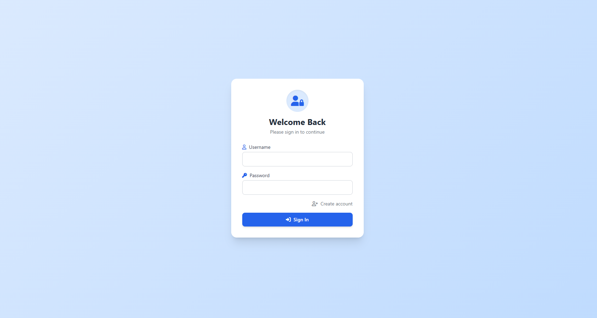
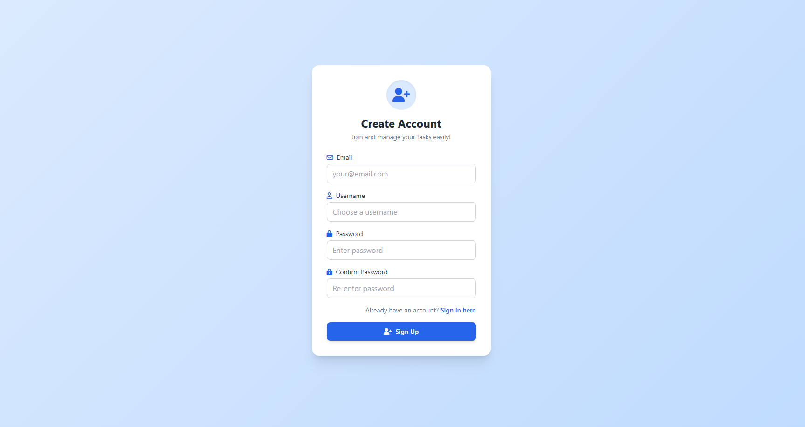
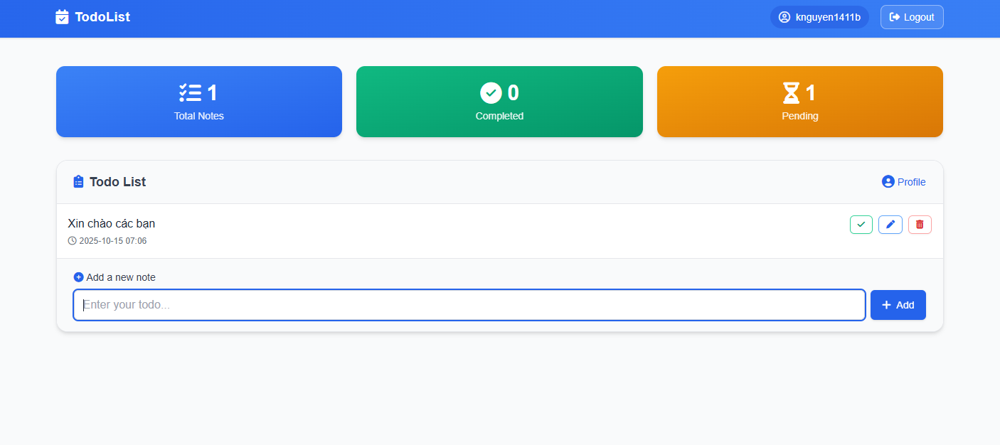
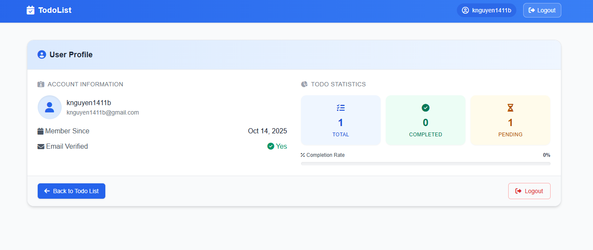

# 📝 TodoList (Flask)

A clean Flask notes and to-do app with authentication, note CRUD, completion tracking, profile statistics, and a small JSON API.

> [!TIP]
> This project is intentionally lightweight: SQLite by default, Tailwind via CDN, and no frontend build step.

## ✨ Features

- 🔐 User auth: sign up, sign in, logout, protected routes
- 🗒️ Notes CRUD: create, edit, delete, mark complete/incomplete
- 📊 Profile dashboard: total, completed, pending, completion rate
- ⚙️ JSON API for note read/update/delete/toggle flows
- 📱 Responsive UI with Jinja2 templates + TailwindCSS + Font Awesome

## ⚙️ Tech Stack

- Backend: Flask, Flask-Login, Flask-SQLAlchemy, SQLite
- Frontend: Jinja2, TailwindCSS (CDN), Font Awesome
- Tooling: python-dotenv, pytest, GitHub Actions

## 📁 Project Structure

```text
app/
  api/           # Route blueprints
  services/      # Business logic
  templates/     # Jinja templates
  utils/         # Helpers & error handlers
  db.py          # SQLAlchemy init
  models.py      # User, Note models
tests/           # Pytest suite
run.py           # App entrypoint
requirements.txt
```

## 🚀 Quick Start

### 1. Install dependencies

```bash
python -m venv .venv
# Windows
.venv\Scripts\activate
# macOS/Linux
source .venv/bin/activate

pip install -r requirements.txt
```

### 2. Configure environment

Create `.env` from `.env.example` and update values.

```env
KEY=your_secret_key
DB_NAME=instance/todolist.db
HOST=0.0.0.0
PORT=5000
DEBUG=true
```

### 3. Run the app

```bash
python run.py
```

Open `http://localhost:5000`.

## 🧪 Testing

```bash
pytest
```

The CI workflow also runs tests on Python 3.10, 3.11, and 3.12 for pushes and pull requests to `main`.

## 🌐 Main Routes

### Web

- `GET /`, `POST /`: Home page + add note (login required)
- `POST /edit-note/<id>`: Update note
- `POST /delete-note/<id>`: Delete note
- `POST /complete-note/<id>`: Toggle completion
- `GET/POST /signin`: Sign in
- `GET/POST /signup`: Register
- `GET /logout`: Logout
- `GET /profile`: User profile

### API

- `GET /api/notes?completed=true|false`: List notes by status
- `GET /api/notes/<id>`: Get note details

## ☁️ Deployment Notes

- SQLite file is created automatically.
- On Vercel environments, DB is stored in `/tmp/todolist.db`.
- For production, use a strong `KEY` and run behind a production WSGI server.

## 🖼️ Demo Screenshots

|                  Sign In                   |                  Sign Up                   |
| :----------------------------------------: | :----------------------------------------: |
|  |  |

|                    Home                     |                   Profile                   |
| :-----------------------------------------: | :-----------------------------------------: |
|  |  |

---

Made by Knguyen1411b
